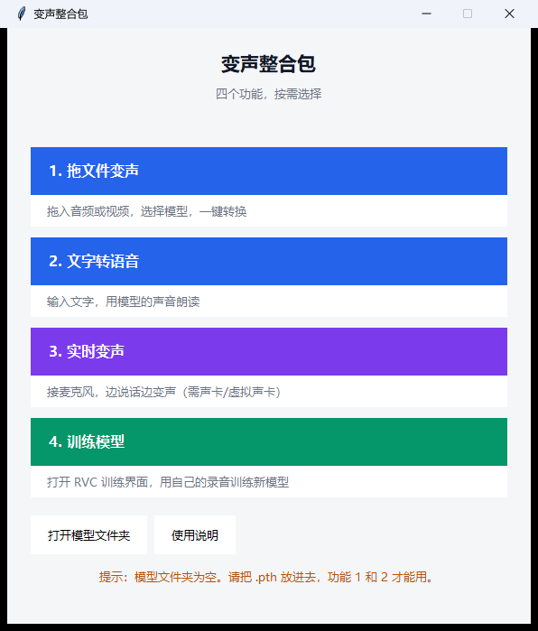
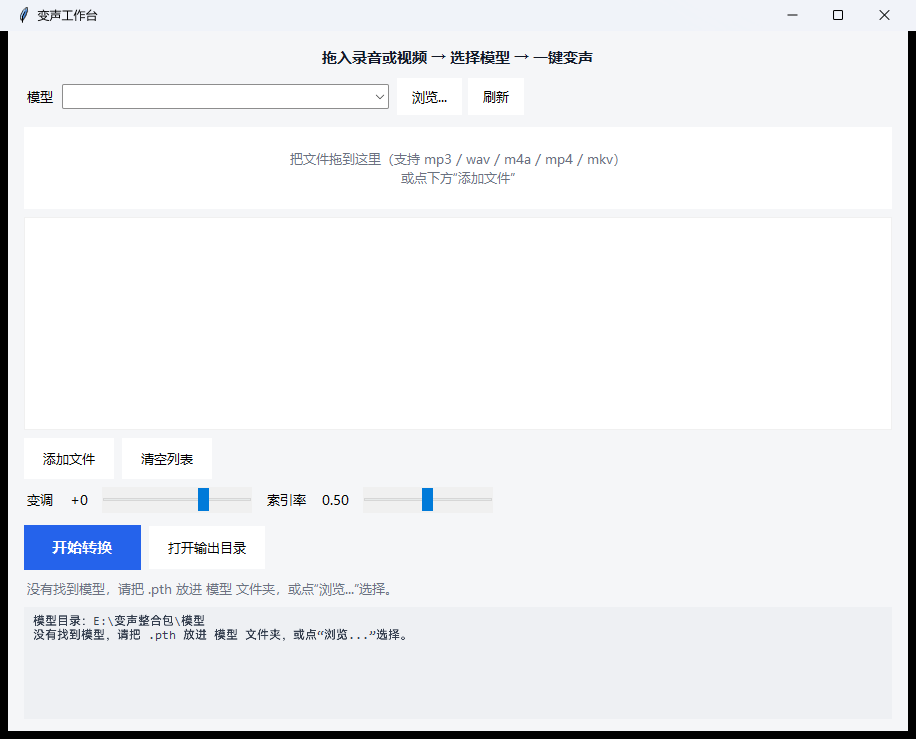

# 变声整合包 · Voice Workbench

一个基于 [RVC](https://github.com/RVC-Project/Retrieval-based-Voice-Conversion-WebUI) 的 Windows 便携工具集：
**拖文件变声 / 文字转语音 / 实时变声 / 训练模型**，自带运行环境，解压即用。

> A portable Windows voice-conversion toolkit built on RVC: file conversion, TTS, realtime voice changing, and model training — with a bundled runtime, no Python setup required.



## 功能

| 功能 | 说明 |
|---|---|
| **拖文件变声** | 拖入 mp3 / wav / m4a / mp4 / mkv，选模型，一键转换 |
| **文字转语音** | 输入文字 → 用模型音色朗读（edge-tts + 音色转换） |
| **实时变声** | 接麦克风 / 虚拟声卡，边说话边变声 |
| **训练模型** | 打开 RVC 网页界面，用自己的录音训练 40k 模型 |



## 系统要求

- Windows 10 / 11 64 位
- NVIDIA 显卡：推理 4 GB 显存起，训练建议 8 GB 起
- 内存 16 GB 以上，磁盘预留 10 GB
- 没有 N 卡也能用 CPU 推理，但慢很多

## 快速开始

1. 到 [Releases](../../releases) 下载便携包（分卷压缩，需全部下载后一起解压）
2. 把自己的 `.pth` / `.index` 放进 `模型\` 文件夹
3. 双击 `启动.bat`

**本仓库不包含任何训练好的声音模型。** 模型需要自行训练或获取。

## 目录结构

```
启动.bat
launcher.py            启动器
说明.txt               详细使用文档
RVC\                   运行环境（Python + PyTorch + ffmpeg + 预训练权重）
 tools\workbench\      拖文件变声（源码）
 tools\tts\            文字转语音（源码）
模型\                  .pth / .index 放这里
```

发布包里的 `工具\` 对应本仓库的 `tools\`，代码相同，只是目录名做了本地化。

## 变调怎么设

| 输入 → 目标 | pitch |
|---|---|
| 自己录 → 自己模型 | 0 |
| 男声 → 男声模型 | 0 ~ -6 |
| 女声 → 男声模型 | -12 |
| 高音女声 → 低音男声 | -17 左右 |

设错会得到「目标音色 + 原说话人音高」的怪声，这不是模型坏了，是变声的物理规则。

## 训练自己的模型

训练界面由启动器的「4. 训练模型」打开（RVC WebUI，`127.0.0.1:7897`）。

基本流程：

1. 准备 **10–20 分钟干净人声**（无 BGM、无混响最佳；可从视频里用 UVR 分离）
2. 训练页填实验名 → 预处理 → 提取特征
3. 轮数 200 左右，8 GB 显存建议 batch size 6
4. 训练 → 生成索引
5. 产物在 `RVC\assets\weights\`，复制到 `模型\` 即可使用

细节见 [docs/使用说明.md](docs/使用说明.md)。

## 常见问题

**双击没反应？** 看根目录的 `错误.log`。

**模型下拉框是空的？** 模型没放进 `模型\`，或文件名含中文。

**转换报 faiss 错误？** 索引路径含中文。程序会自动复制到临时目录；仍失败请用纯英文路径。

**实时变声没声音？** 检查输入输出设备、虚拟声卡路由、是否点了 Start。

**杀毒报毒？** PyTorch 与打包程序的常见误报，加入信任即可。

## 从源码运行

本仓库是工具源码。要跑起来还需要：

1. 一份 RVC 1006 Nvidia 整合包，放在仓库同级的 `RVC\` 目录
2. 安装 `tkinterdnd2`（拖拽支持）：`RVC\runtime\python.exe -m pip install tkinterdnd2`

```bat
python RVC\runtime\python.exe launcher.py
```

## 许可证

- 代码：MIT，见 [LICENSE](LICENSE)
- 模型：**不在本仓库内**。若你训练了自己的模型，请自行决定授权范围

## 免责声明

本项目仅提供工具。使用者需对自己生成的内容负责：

- 禁止冒充他人身份、诈骗、伪造他人言论
- 使用他人声音训练模型必须获得本人授权
- 作者不对使用者的行为承担任何责任

## 致谢

- [RVC Project](https://github.com/RVC-Project/Retrieval-based-Voice-Conversion-WebUI)
- [UVR5](https://github.com/Anjok07/ultimatevocalremovergui) 人声分离
- [edge-tts](https://github.com/rany2/edge-tts) 语音合成
- PyTorch / faiss / librosa / soundfile
